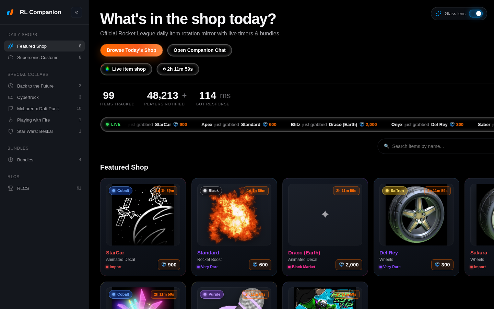
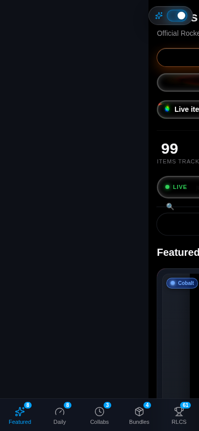

# RL Companion

A fast, Apple-style **Rocket League daily item shop mirror**. See exactly what's in
the shop today — items, prices, paints, rarities, bundles, and live countdown
timers — without launching the game.

Built around a **liquid-glass** design language (React Bits `GlassSurface`,
`Beams`, `FluidGlass`, `SpecularButton`, `Counter`) on top of React + Three.js,
with real shop data fetched from Rocket League's own internal API.

<p align="center">
  
</p>

<p align="center">
  
</p>

---

## Features

- **Live daily shop** — item rotation with per-item countdown timers
  (`1d 5h 41m`, etc.), pulled from the real game data.
- **Real item art** — game thumbnails resolved through a multi-source asset
  pipeline (Psyonix CDN → community thumbnails → RL Garage).
- **In-game rarity glow** — each card is tinted with its authentic rarity color
  (Black Market, Exotic, Import, Limited, …).
- **Bundles** — expandable bundle cards showing every included item, paint and
  price.
- **Collab shops** — Cybertruck, Star Wars: Beskar, Playing with Fire, Back to
  the Future, McLaren x Daft Punk, RLCS and more (nav is derived from whatever
  is actually in today's rotation).
- **Search + filters** — filter by item type, paint, and rarity with the full
  game vocabulary (nothing becomes unfilterable).
- **Favorites** — save items locally and reopen them from a detail modal.
- **Live activity ticker** — an animated "… just grabbed …" marquee.
- **Animated counters** — items tracked / players notified / bot response.
- **Liquid-glass UI** — a WebGL `Beams` background, `GlassSurface` panels and
  pills, specular search/filter buttons, a **cursor-following fluid-glass lens**
  (toggle top-right, or press `g`), and a **draggable glass chat bubble**.
- **Responsive** — desktop sidebar + mobile bottom tab bar and top bar.

## Tech stack

| Layer | Tech |
| --- | --- |
| UI | React 18, Vite 5 |
| 3D / WebGL | three.js, @react-three/fiber, @react-three/drei |
| Glass effects | React Bits (`GlassSurface`, `Beams`, `FluidGlass`, `SpecularButton`, `Counter`) |
| Primitives | Base UI (`@base-ui/react`, shadcn/base-nova) |
| Motion | motion (Framer), GSAP |
| Tests | Vitest + Testing Library |

## Project structure

```
.
├── app/                     # React + Vite frontend
│   ├── public/
│   │   ├── rl-art/          # item artwork (webp)
│   │   └── assets/3d/       # fluid-glass lens GLB models
│   ├── src/
│   │   ├── App.jsx          # main app
│   │   ├── data.js          # demo seed + shop/nav vocabulary
│   │   ├── components/      # Sidebar, BottomBar, ui/ (Select, Switch, Sidebar)
│   │   └── reactbits/       # GlassSurface, Beams, FluidGlass, GlassLens, …
│   └── vite.config.js
├── tools/fetch-shop/        # Go + Python data pipeline (RL internal API → shop.json)
├── data/                    # fallback demo data + item art index
├── server.js                # tiny production server (serves app/dist + /api/shop)
└── docs/screenshots/        # README screenshots
```

## Getting started

Prerequisites: **Node 18+**.

```bash
cd app
npm install
npm run dev
```

Open <http://127.0.0.1:5173/>. The dev server serves the app, `/api/shop`, and
the repo-static assets from disk.

> If `npm install` blocks the `esbuild` postinstall script, approve it:
> `npm install-scripts approve esbuild && npm rebuild esbuild`.

## Tests

```bash
cd app && npm test
```

Runs the Vitest suite (29 tests: layout, shop switching, search, filters,
favorites, modal, and `/api/shop` fetch).

## Build & run (local production)

```bash
cd app && npm run build
cd .. && node server.js        # http://127.0.0.1:4173
```

`server.js` serves the built `app/dist` SPA **plus** a real `/api/shop` endpoint
and the repo-root assets, and starts the daily auto-refresh.

## Data pipeline

Live data comes from `tools/fetch-shop/`, which talks to Rocket League's own
internal API (`Shops/GetStandardShops` / `GetShopCatalogue` via the
`wss://ws.rlpp.psynet.gg` WebSocket, authenticated through Epic Online Services),
merges it with community name/quality dumps, and resolves item art. See
[`tools/fetch-shop/README.md`](tools/fetch-shop/README.md) for the full details.

One-time setup (needs a free Epic account login):

```bash
cd tools/fetch-shop
go run .          # prints an Epic login URL + code; saves a refresh token
./refresh.sh      # go run . → convert.py → resolve-art.py → out/shop.json
```

**Automatic daily refresh** — both `server.js` and the Vite dev middleware load
`tools/fetch-shop/auto-refresh.mjs`, which re-runs the pipeline whenever
`out/shop.json` is older than 20h. So as long as a server is running, the site
refreshes itself daily with **no cron and no manual steps**.

## GitHub Pages

The app ships with a GitHub Actions workflow (`.github/workflows/deploy.yml`)
that builds `app/` with the correct base path and publishes it to GitHub Pages
on every push to `main`.

**Publish link:** <https://github.com/batyass/rl-companion/settings/pages>

One-time setup:

1. Open the link above (or go to **Settings → Pages**).
2. Under **Build and deployment → Source**, select **GitHub Actions**.
3. Push to `main` — the workflow runs and deploys automatically.

The site will then be live at:

> <https://batyass.github.io/rl-companion/>

### Static-hosting caveat

GitHub Pages is static, so there is no `/api/shop` backend. On Pages the app
falls back to the bundled **demo seed** (`app/src/data.js`) with its included
artwork — everything works, but the rotation is a snapshot rather than the live
shop. For live data, run the dev server or `node server.js`.

## Disclaimer

Not affiliated with Psyonix or Epic Games. Rocket League and its assets are the
property of their respective owners. The data fetcher targets a
reverse-engineered community API (github.com/dank/rlapi) and is intended for
personal/educational use only.
